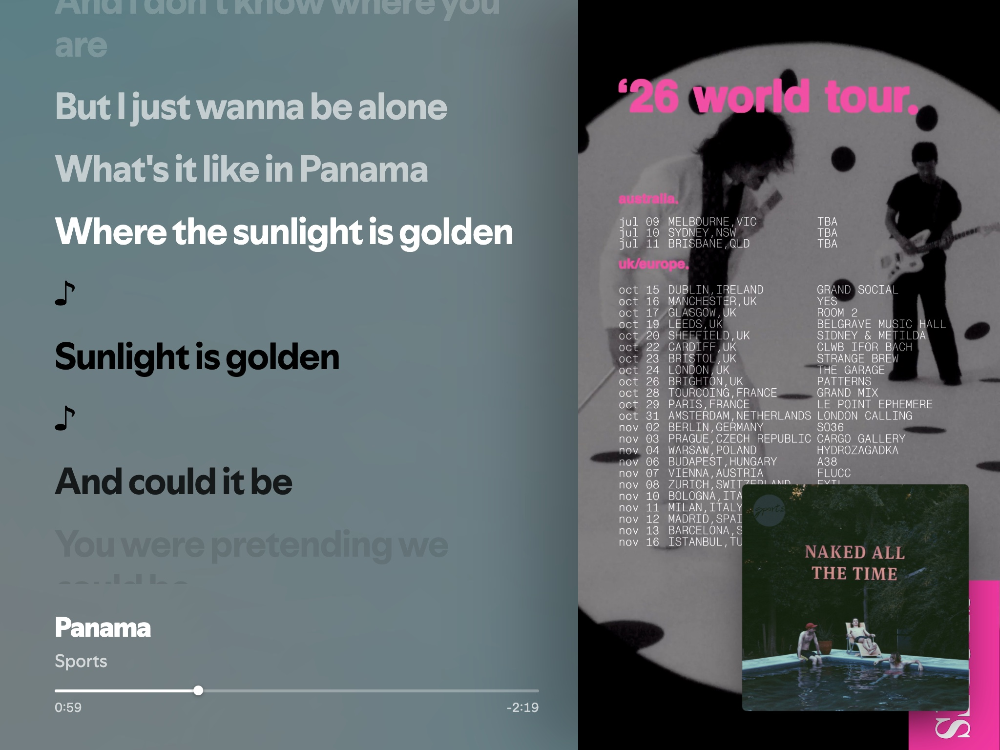
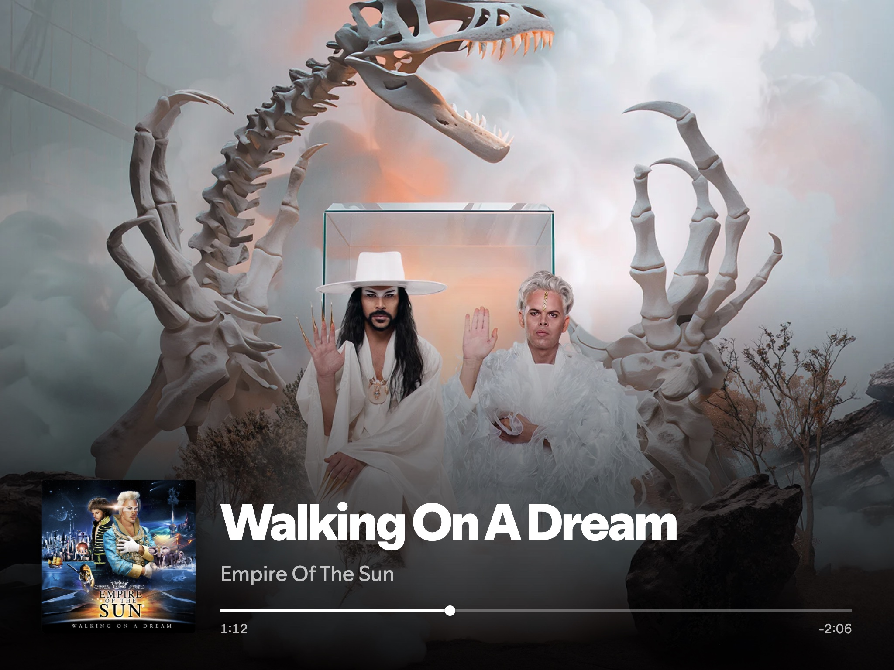
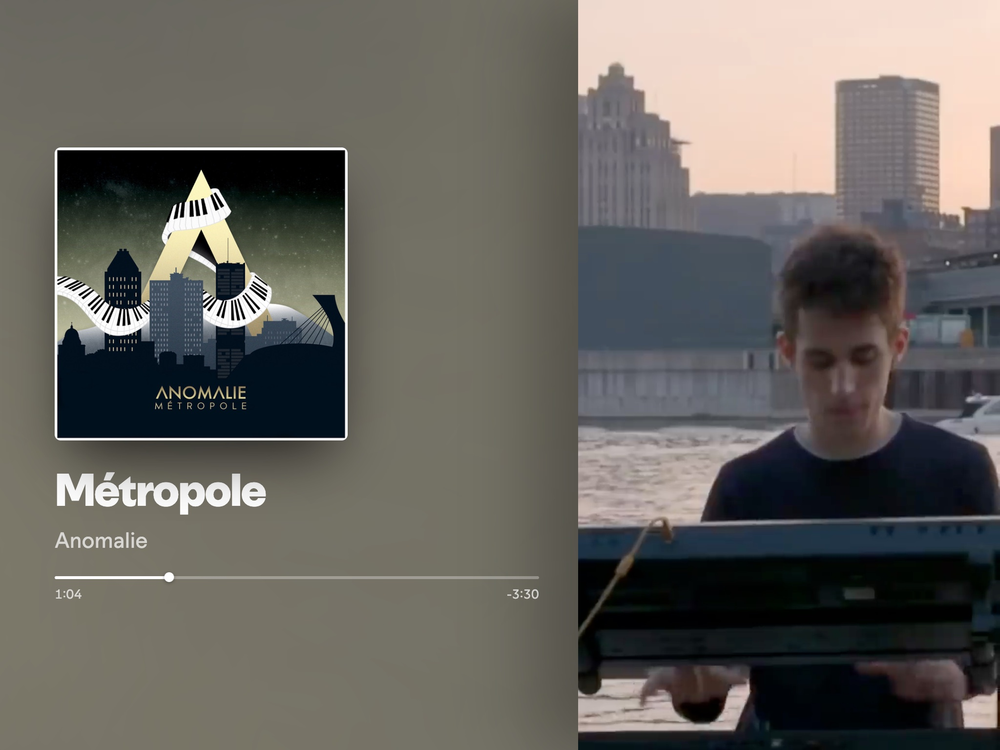
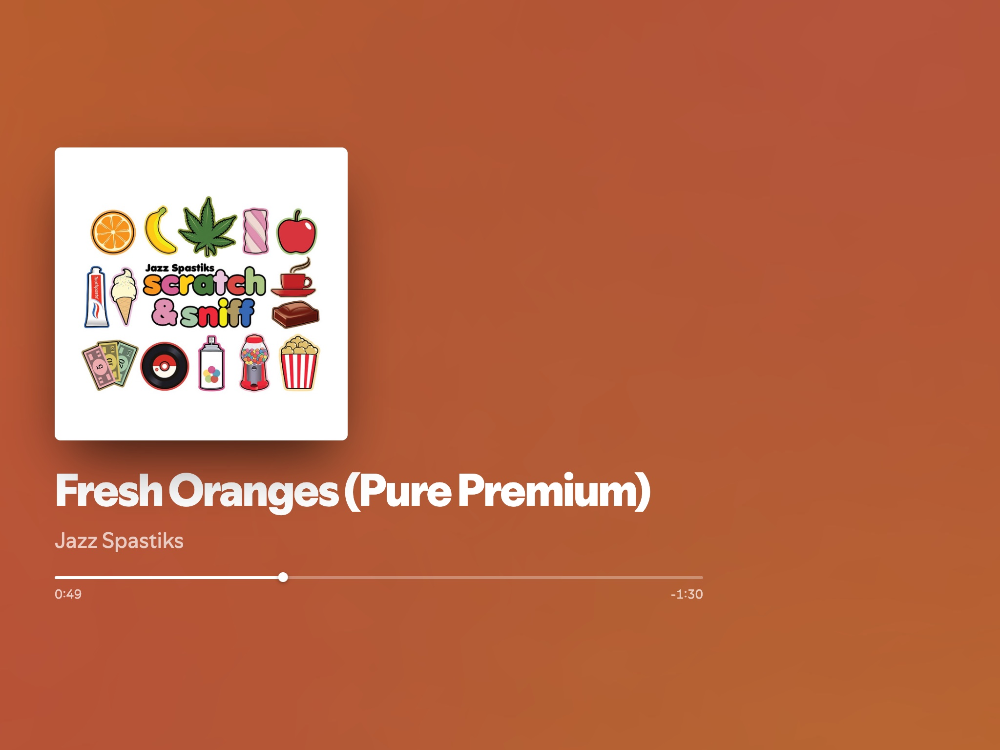
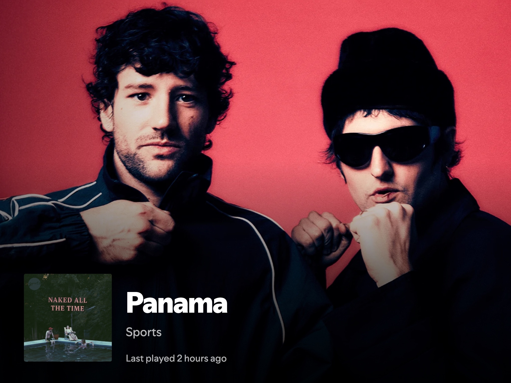
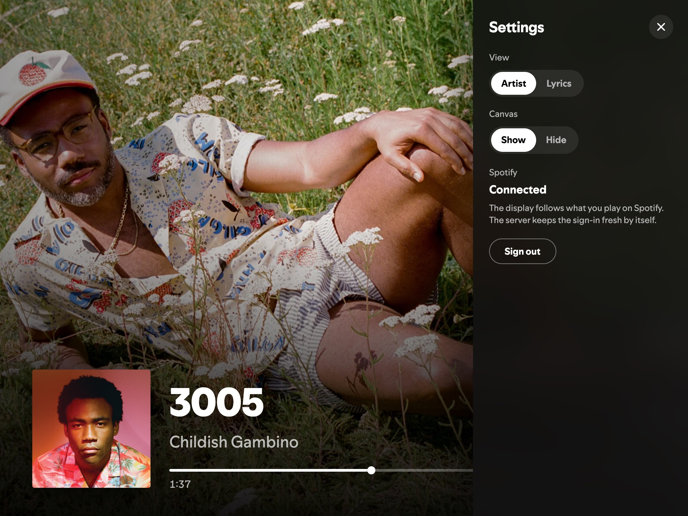
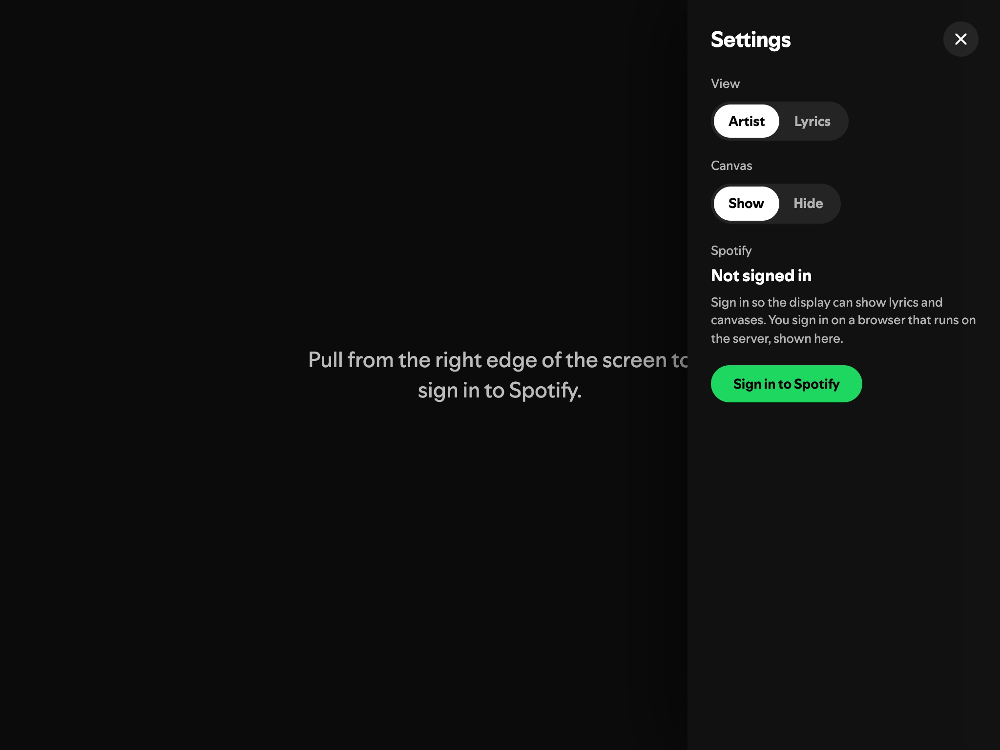
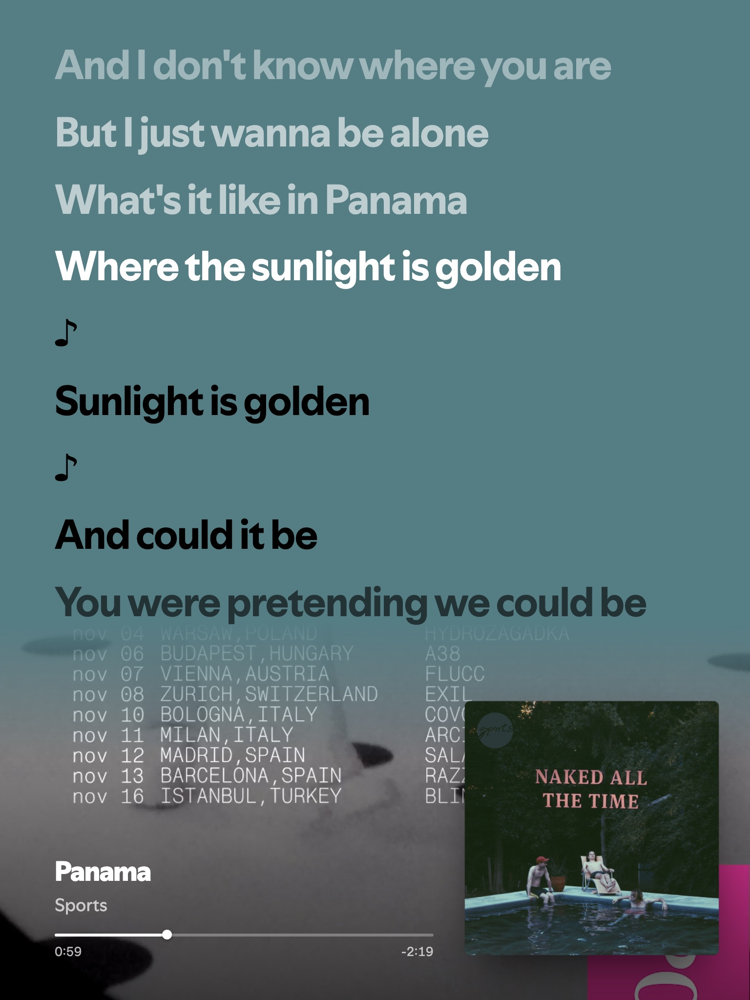
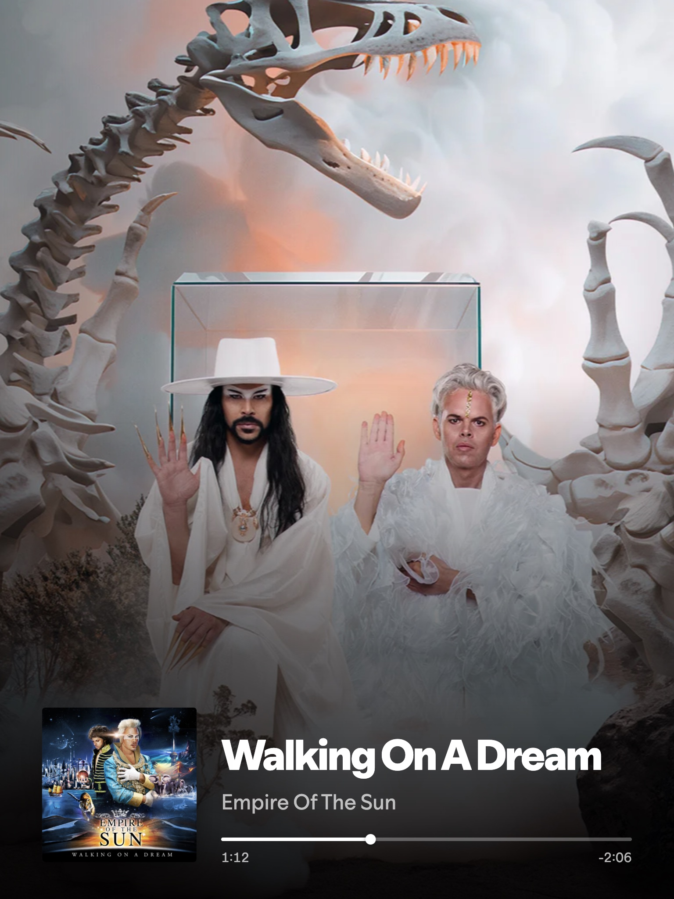

# Now Playing

A Spotify "now playing" wall display for an iPad Air 2. A small Python server follows
whatever you are playing on Spotify, and the iPad shows it full screen: the artist's banner,
the album art, Spotify's own time-synced lyrics in Spotify's lyric colours, and the song's
canvas video.



## Screenshots

All taken from the real page at the iPad Air 2's resolution (2048 × 1536), with every detail
from Spotify.

<table>
<tr>
<td width="50%"><br><b>Artist view</b>: the artist's banner, slowly drifting, with the album art, title and Spotify's progress bar. <i>Walking On A Dream, Empire Of The Sun</i></td>
<td width="50%"><br><b>Lyrics, no canvas</b>: synced lines in Spotify's colours over slow gradients taken from the album art. <i>3005, Childish Gambino</i></td>
</tr>
<tr>
<td><br><b>Lyrics and canvas</b>: the canvas plays uncropped on the right, and the album art lines up with the time digits. <i>Panama, Sports</i></td>
<td><br><b>No lyrics, with a canvas</b>: the album art moves over the title. <i>Métropole, Anomalie</i></td>
</tr>
<tr>
<td><br><b>No lyrics, no canvas</b>. <i>Fresh Oranges (Pure Premium), Jazz Spastiks</i></td>
<td><br><b>Nothing playing</b>: the last song stays up, with when it was played.</td>
</tr>
<tr>
<td><br><b>Settings</b>: pull from the right edge. View, canvas on or off, and the Spotify connection.</td>
<td><br><b>First run</b>: sign in to Spotify from the same pane.</td>
</tr>
</table>

Portrait follows the iPad: the canvas fills the screen behind the lyrics.

<p>


</p>

## Using it

- Tap the screen to switch between the artist view and the lyrics view.
- Drag left from the right edge to pull out the settings pane. The strip there is invisible
  and a tap does nothing, so nothing on screen gives it away. The view and canvas choices
  are saved on the iPad.
- The page turns with the iPad, and fills the screen when opened from the home screen.

## How it works

`server.py` (Python standard library only) serves the page and two kinds of Spotify data:

- **What is playing**: `GET /v1/me/player` on the public Web API, through your own Spotify
  developer app (Authorization Code with PKCE, scope `user-read-playback-state`, no client
  secret). It asks every 2 s while playing, 5 s while paused and 15 s when idle, and only
  while a display has the page open. When nothing is playing it keeps showing the last song.
- **Everything else, once per song**: track details, the artist banner and the canvas from
  the web player's Pathfinder API, and the lyrics with their colours from `color-lyrics`.
  These need the `sp_dc` cookie of a signed-in Spotify web session.

Signing in happens on the server. `signin.py` runs real Google Chrome inside the container
on a virtual screen (Xvfb), and the settings pane shows it as a live picture: taps become
clicks and the text box under it types into the page. Once Spotify sets `sp_dc`, the server
saves it and uses the same browser to approve your developer app. The browser profile is
kept, so when the cookie expires the server renews it by itself. The browser closes when it
is not needed.

The page asks the server `GET /api/now` every 1.5 to 3 s and runs the progress bar and the
lyrics on its own clock in between.

| Endpoint | |
| --- | --- |
| `GET /api/now` | what is playing (or was last), with progress |
| `GET /api/song?track=<id>` | title, artists, album art, banner, canvas URL, lyrics and colours for one track |
| `GET /api/status` | sign-in and player connection state |
| `POST /api/signin/start`, `/input`, `/cancel`, `GET /api/signin/frame` | the sign-in browser |
| `POST /api/signout` | forget the cookie, tokens and browser profile |

## Setup

### 1. A Spotify developer app

Create an app at [developer.spotify.com/dashboard](https://developer.spotify.com/dashboard)
with the Web API, and add this redirect URI:

```
http://127.0.0.1:8899/callback
```

Nothing listens there: the server's browser catches the redirect itself. Note the client ID.

### 2. Fonts (optional)

The page uses Spotify Mix, Spotify's own typeface, which is not in this repository. Fetch it
from Spotify's web player into `web/fonts/`:

```sh
tools/get-fonts.sh
```

Without it the page falls back to Helvetica Neue.

### 3. The server

It runs as a rootless Podman container (Debian with Python 3.12, Playwright and Google
Chrome). On the server, put the client ID in an env file:

```sh
mkdir -p ~/.config/now-playing && chmod 700 ~/.config/now-playing
echo 'NP_CLIENT_ID=<your client id>' > ~/.config/now-playing/env
chmod 600 ~/.config/now-playing/env
```

Then, from this folder:

```sh
HOST=user@server tools/deploy.sh
```

It copies the files over ssh, builds the image, installs the systemd Quadlet unit
(`deploy/now-playing.container`) and starts it on port 8092. Without Quadlet:

```sh
podman build -t now-playing .
podman run -d --name now-playing -p 8092:8092 --init --userns=keep-id \
  --env-file ~/.config/now-playing/env -v ~/.config/now-playing:/config:Z now-playing
```

`~/.config/now-playing` holds the cookie, the player tokens, the last song and the browser
profile.

| Variable | Default | |
| --- | --- | --- |
| `NP_CLIENT_ID` | (none) | your developer app's client ID |
| `NP_PORT` | `8092` | |
| `NP_SPDC_FILE` | `~/.config/now-playing/sp_dc` | the cookie; the other files sit next to it |
| `NP_PROFILE_DIR` | next to the cookie, `browser/` | the sign-in browser's profile |

`python3 server.py` also runs without the container. Without Playwright the sign-in pane is
off, and the player cannot be connected.

### 4. The iPad

Open `http://<server>:8092/` in Safari, then Share → Add to Home Screen, and open it from
the home screen so it runs full screen. Pull out the settings pane, tap **Sign in to
Spotify**, sign in on the picture of the server's browser, then tap **Allow** when Spotify
asks to let the display see what is playing.

Set Auto-Lock to Never. While music plays, the page also loops a muted video two pixels
wide in a corner, because iOS sleeps the screen about eight minutes after the last touch
even then.

## Notes

- Canvases, artist banners and lyrics come from the private API that Spotify's web player
  uses, signed in with your own cookie. That is against Spotify's terms of use and can break
  whenever Spotify changes it. The server re-reads the web player's query hashes and TOTP
  secrets when they change, but it may still need fixing now and then.
- The settings pane has no password: anyone on your network who opens the page can sign the
  display in or out. Keep it on your home network.
- Opened without a server (for example as a file), the page shows a made-up sample song
  with stock stand-in media from `web/media/sample/`.
- Not affiliated with Spotify. The album art, artist images, canvases and lyrics in the
  screenshots belong to their owners.
